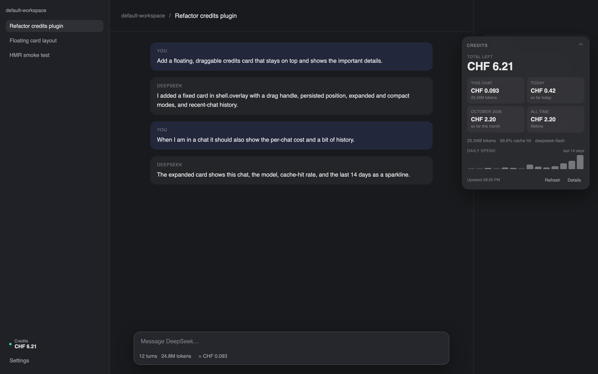
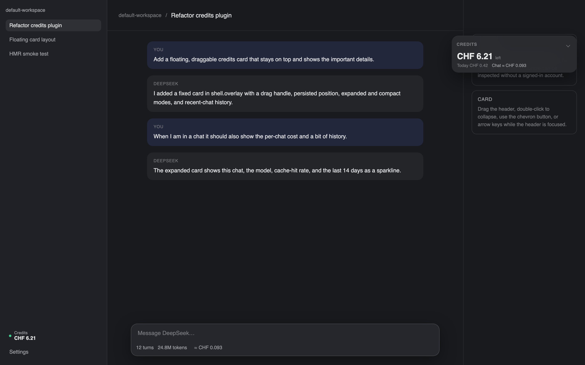

# dsh-credits

Always-visible DeepSeek credits and usage for the DSH Web GUI. No need to open
Settings → Account.

- **Floating card** — a persistent card that floats above the app's content
  and can be dragged anywhere in the window. It is monochrome and reports
  Swiss francs only: total left, this chat, today, the month, all time, and
  the last 14 days of spend. The card keeps a constant width; the chevron, a
  double-click on the header, or Enter collapses it to the essentials. In a
  chat it adds the chat's token count, cache-hit rate and model; outside a
  chat it lists the last few chats from this device. Dragging follows the
  pointer with a short spring, a flick keeps gliding, and the position plus
  collapsed state persist per device.
- **Sidebar chip** — total credits left, in CHF, above the Settings / account
  row. A dot turns amber when the balance drops below a configurable threshold.
- **Composer pill** — an estimated cost for the current chat, next to the
  existing token/cache statistics: `≈ CHF 0.16`.
- **Details panel** — click the chip, the pill, or the card's **Details** button
  to see:
  - total left (CHF + native wallet amounts)
  - this chat (estimated), today, this month, all time
  - topped-up and granted balances
  - last 14 days of spend as a sparkline
  - this month's spend by model
  - this month's tokens: cache hit / miss / output / requests / cache-hit rate
  - the live FX rate and the pricing assumption used for the chat estimate
  - refresh and a link to the Platform usage page

All money figures in the floating card are Swiss francs only. The details
panel converts every figure to CHF and keeps the native CNY/USD amounts
alongside so the conversion stays auditable.

## Data sources

| Data | Source |
|---|---|
| Wallet balance, bonus balance, all-time spend | `ctx.deepseekAccount.getPlatformSession()` → Platform `GET /api/v0/users/get_user_summary` |
| This month's cost, daily costs, per-model costs, tokens | Platform `GET /api/v0/usage/cost` and `GET /api/v0/usage/amount` (private dashboard endpoints, the same ones the Platform usage page loads) |
| CHF rate | [Frankfurter](https://frankfurter.dev/) ECB reference rates, cached for 6 hours, with configurable fallback |
| Per-chat estimate | DSH's provider-reported `tokenUsage` session projection × current DeepSeek list prices |
| Recent chats on the floating card | Recorded locally when you leave a chat; stored in `localStorage`, never sent anywhere |

The Platform grant is read on the Host only. The browser route returns
aggregates and never receives an account token. The route reuses
`ctx.connection.admit()` so it is readable only by the authenticated app
document (unauthenticated loopback requests get `401`).

## Install

From a checkout of this directory:

```sh
dsh plugin --profile desktop add link:/path/to/dsh-credits
```

The package declares a bundle patch, so the command adds both the dependency
and the bundle. HMR picks it up; no restart is required on a profile with
configuration watches.

For a normal `dsh web` profile, replace `desktop` with that profile name.

## Configure

Every field is optional. Put overrides in the profile's `cordis.patch.yml`
(note `config:` — a top-level key is ignored by the loader):

```yaml
- id: dsh-credits
  name: dsh-credits
  config:
    defaultModel: deepseek-flash   # model used for the per-chat estimate
    lowBalanceChf: 2               # amber warning below this CHF amount
    floatingCard: true             # show the draggable credits card
    refreshSeconds: 60             # client poll interval
    fxFallbackRates:
      CNY: 8.05
      USD: 1.21
```

The loader row config is merged over the defaults in `lib/index.js`.

## Uninstall

```sh
dsh plugin --profile desktop remove dsh-credits
```

If you added a `- id: dsh-credits` override to the profile's
`cordis.patch.yml`, delete that block as well.

## Estimate limits

- The per-chat number is an **estimate**, not a Platform billing record. It
  prices the session's provider-reported token buckets with the list prices
  below and marks the result with `≈`. The actual charge for a request is the
  Platform's own cost row.
- Peak pricing uses Beijing weekdays 09:00–12:00 and 14:00–18:00. Chinese
  public holidays are not modelled, so a holiday weekday is priced as peak.
- Cache-write tokens are priced as cache-miss tokens (DeepSeek currently
  reports no separate cache-write price).
- The Platform's “today” bucket follows the Platform's own calendar; the panel
  asks for the current local date and falls back to the latest bucket when the
  exact date is not present yet.
- Monthly/daily usage endpoints are private dashboard endpoints and may change
  without notice. Balance is read from the account service, not scraped.

## Price table

Per 1M tokens, CNY (off-peak / peak) and USD (off-peak / peak):

| Model | Cache hit | Cache miss | Output |
|---|---|---|---|
| `deepseek-flash` | ¥0.02 / ¥0.04 | ¥1 / ¥2 | ¥4 / ¥8 |
| `deepseek-v4-pro` | ¥0.15 / ¥0.30 | ¥4.5 / ¥9 | ¥13.5 / ¥27 |
| `deepseek-flash` | $0.003 / $0.006 | $0.15 / $0.30 | $0.60 / $1.20 |
| `deepseek-v4-pro` | $0.022 / $0.044 | $0.66 / $1.32 | $1.98 / $3.96 |

Update `PRICE_TABLE` in `lib/index.js` if DeepSeek changes list prices.

## Preview

The floating card, expanded in a chat and collapsed to the essentials:





## Development checks

```sh
node --check lib/index.js
node --check lib/client.js
node test/client-smoke.mjs      # bundle format + slot registrations
node test/host-live.mjs         # live Platform query using the local grant
```

`test/host-live.mjs` reads the local account credential only to exercise the
host route outside the app; production code always goes through
`ctx.deepseekAccount`.

## Files

| File | Role |
|---|---|
| `lib/index.js` | Host half: authenticated `/api/dsh-credits` route, Platform queries, FX cache, price table |
| `lib/client.js` | Browser bundle: floating card, sidebar chip, composer pill, details panel, shared poller |
| `cordis.patch.yml` | Bundle layer that mounts the host half |
| `test/client-smoke.mjs` | Loads the bundle with a fake module loader/DOM/slots |
| `test/host-live.mjs` | Live probe against the signed-in Platform account |
